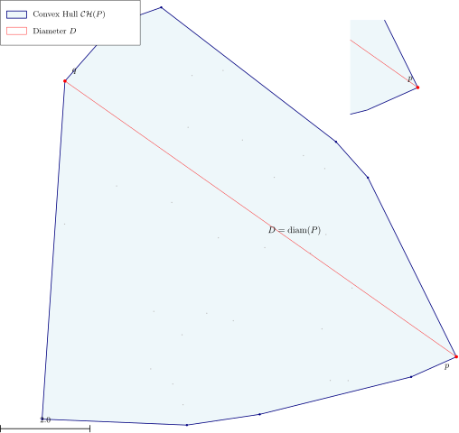

# BasicCompGeometry.jl

[](https://github.com/sarielhp/BasicCompGeometry.jl/actions)
[](https://codecov.io/gh/sarielhp/BasicCompGeometry.jl)
[](https://sarielhp.github.io/BasicCompGeometry.jl/dev)
[](LICENSE)

Computational-geometry primitives, spatial data structures, algorithms, and
vector figures for Julia. The package provides points, segments, and bounding
boxes in arbitrary dimensions; matrix-backed point sequences; convex hulls,
diameter algorithms, bounding box trees, WSPD, and metric space algorithms.
The core keeps a small dependency set, with optional Cairo and LaTeX extensions.

## Installation

Requires Julia 1.9 or newer. Install the development version described here:

```julia
using Pkg
Pkg.add(url="https://github.com/sarielhp/BasicCompGeometry.jl")
```

For a release available in General, use `Pkg.add("BasicCompGeometry")`.

## Quick start

```julia
using BasicCompGeometry

p = point(0.0, 0.0)
q = point(3.0, 4.0)
dist(p, q)                            # 5.0
is_inside(point(1.0, 1.0), BBox(p, q)) # true

points = PntSeq([p, q, point(0.0, 4.0), point(1.0, 2.0)])
hull = convex_hull(points; kernel=ExactKernel())
exact_diameter(points)              # 5.0
```

The package targets research code, experiments, and figure generation. Most
algorithms use floating-point decisions. `ExactKernel()` supports exact predicates
in selected operations, including the 2D hull; it does not make every algorithm
or construction exact. See the [numerical scope](docs/src/kernels.md).

## Documentation and examples

- [Documentation](https://sarielhp.github.io/BasicCompGeometry.jl/dev): guides and API reference.
- [Imports and Extras](docs/src/imports.md): the v0.5.0 split into 130 default exports and 89 opt-in public helpers.
- [Migration notes](CHANGELOG.md#050---unreleased): the complete list of moved exports.
- [Example catalog](examples/README.md): ready-to-run geometry and figure programs.
- [Vector figures](docs/src/figures.md): editable Ipe source and cropped vector PDFs.
- [Cairo and LaTeX](docs/src/cairo.md): optional drawing extensions and math labels.
- [About](docs/src/about.md): origins, AI contributions, code ownership, and maintenance.

[`examples/convex_hull_figure.jl`](examples/convex_hull_figure.jl) draws a hull
and diameter with math labels, a legend, a scale bar, and an inset:

<p align="center">
  
</p>

Bug reports with a small reproducing example are welcome. Maintenance is
best-effort, with correctness bugs prioritized. Distributed under the [MIT License](LICENSE).
